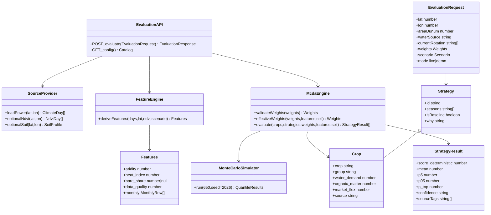
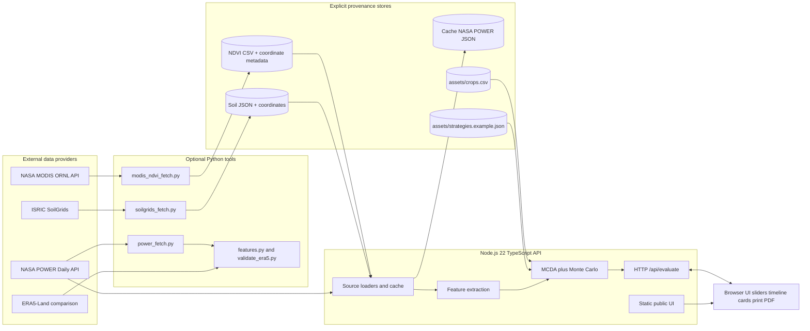
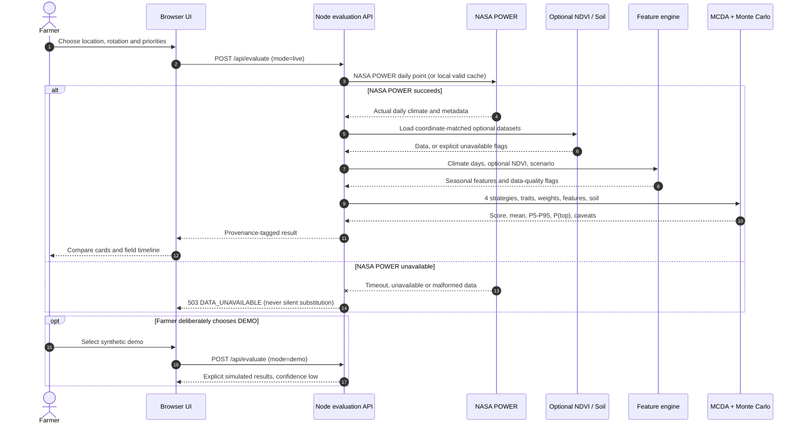
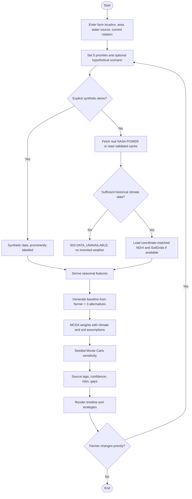
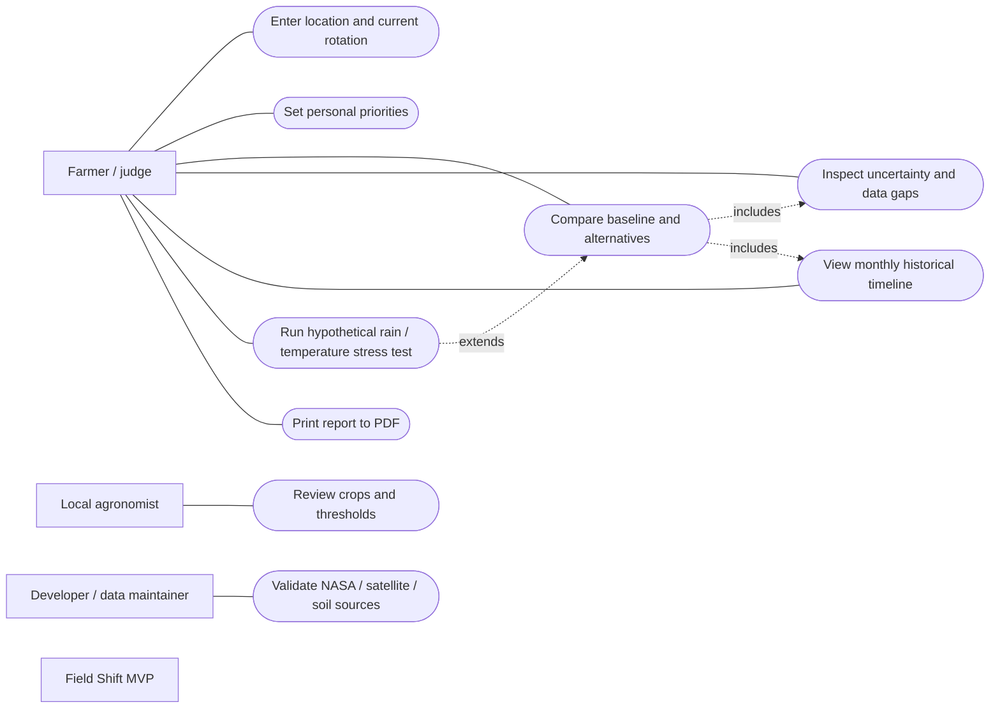
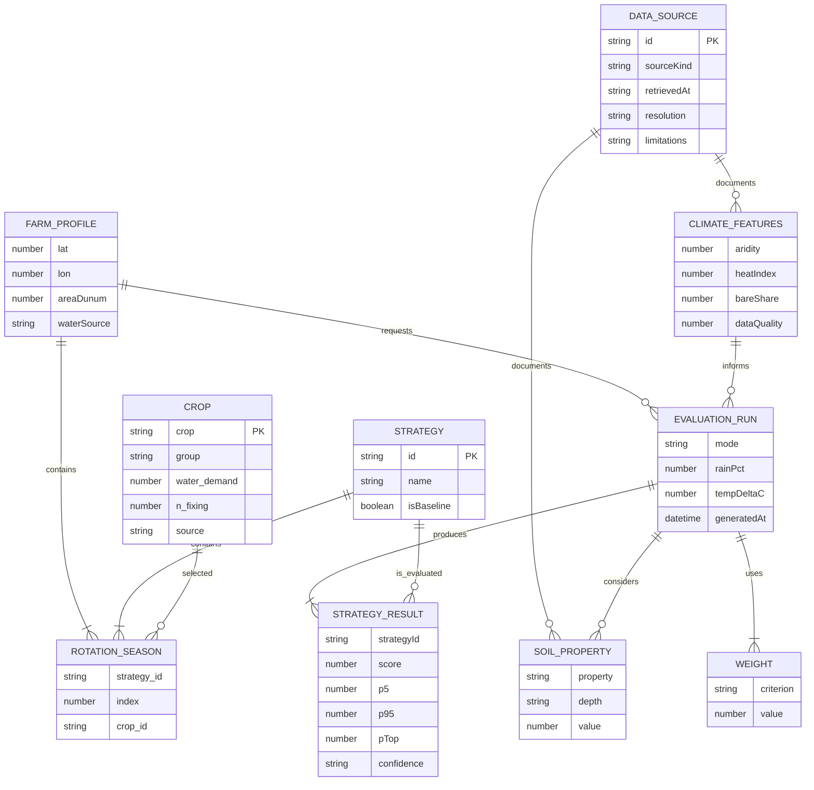

# Field Shift MVP — Implementation diagrams (Node.js / TypeScript, updated)

The original `field_shift_diagrams.md` models Spring Boot. These diagrams describe the **new independent Field Shift MVP** only. The existing Spring Boot/React application remains separate; no assertion of full-stack migration is made. This design follows the six-diagram structure from the uploaded reference.

## 1. Class / domain diagram

## 2. Component diagram

## 3. Sequence diagram

## 4. Activity diagram

## 5. Use case diagram

## 6. Logical entity relationship diagram

The standalone MVP uses JSON/CSV and a file cache, **not PostgreSQL**. This is a conceptual model, not a deployed database schema.

## Technical caveats

The engine does not persist evaluation history or user accounts. All output is a transient HTTP response; browser print provides PDF export. Original Spring Boot decision history remains untouched. Reusing the old `src/main/java` entities here would misleadingly imply a migration that was not performed.
