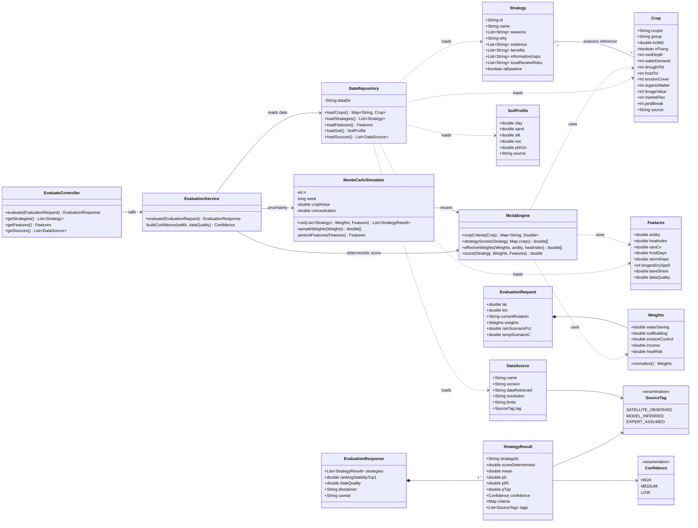
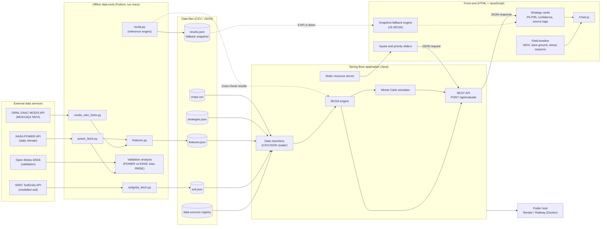
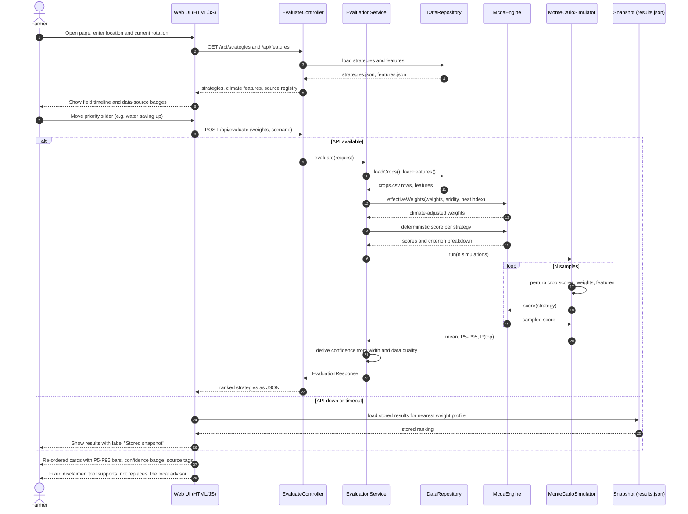
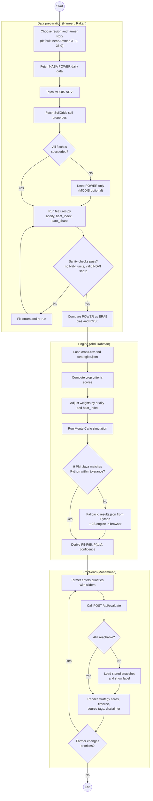
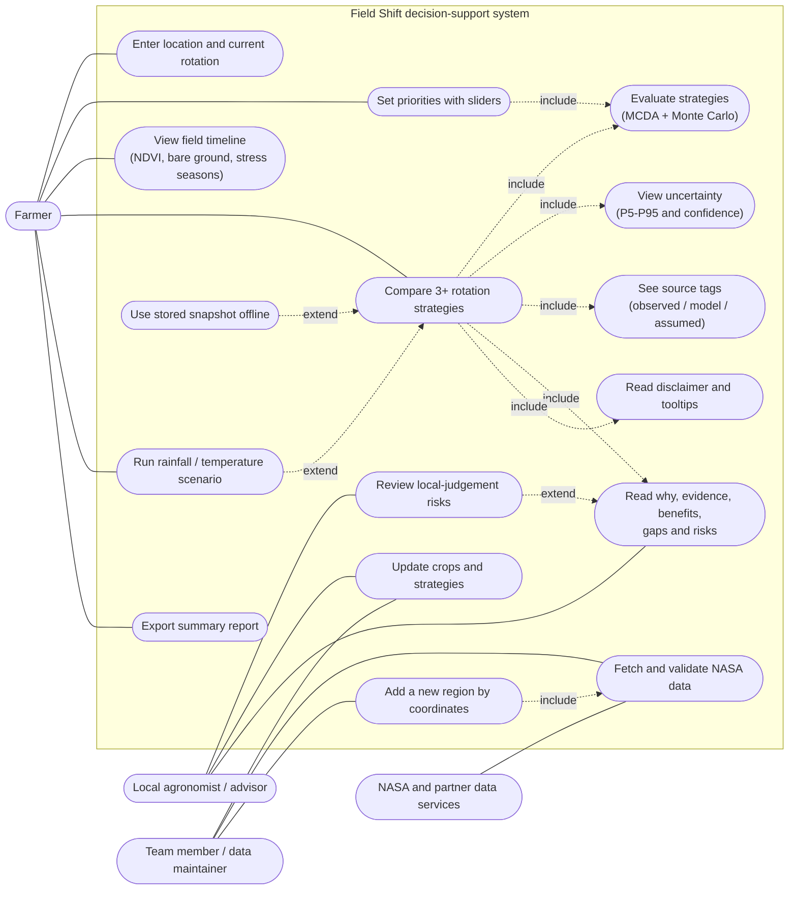
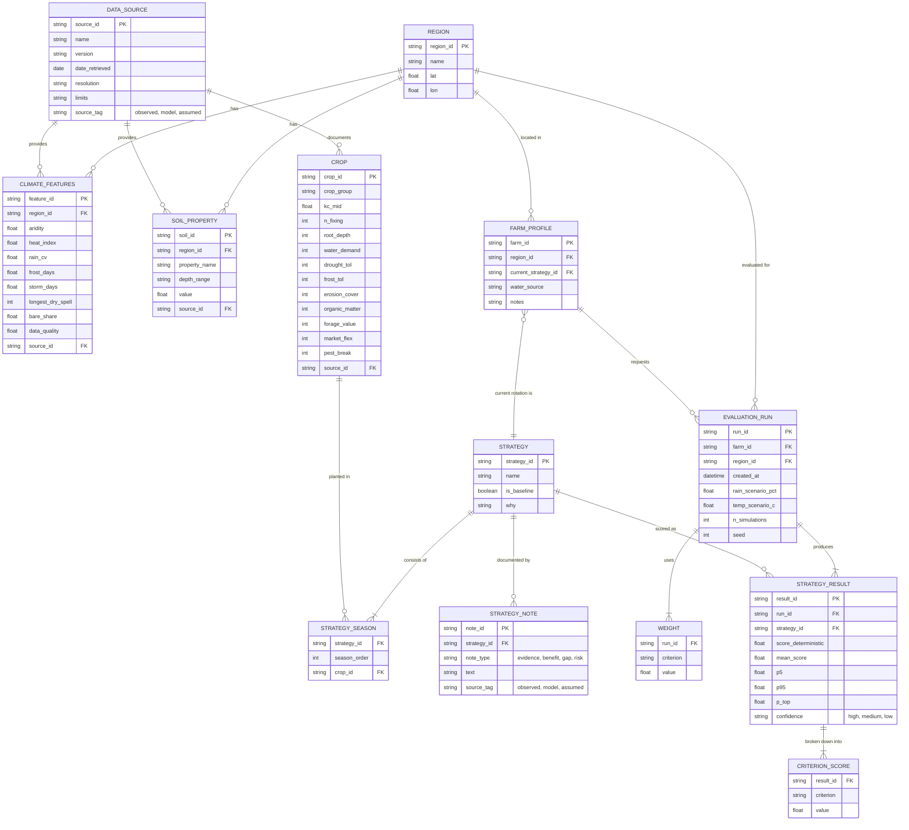

# Field Shift – Mermaid Diagrams

Six diagrams for the Field Shift crop-rotation decision-support tool (NASA Space Apps 2026).
Architecture follows the action plan: Python fetch scripts (run once) -> CSV/JSON files -> Spring Boot engine (MCDA + Monte Carlo) -> HTML/JS (Chart.js) UI.

---

## 1. Class Diagram

Logical classes of the Java (Spring Boot) engine and its data model.

---

## 2. Component Diagram

Mermaid has no native UML component diagram, so a flowchart with subgraphs is used.

---

## 3. Sequence Diagram

Main scenario: the farmer moves a priority slider and the ranking updates (the live demo moment). Includes the API-down fallback.

---

## 4. Activity Diagram

End-to-end workflow, from data fetching to the decision shown to the farmer. Includes the Friday 9 PM decision point.

---

## 5. Use Case Diagram

Mermaid has no native use case notation, so actors and use cases are drawn with a flowchart.

---

## 6. Entity-Relationship Diagram (ERD)

Logical data model. The project uses CSV/JSON files instead of a database, so each entity maps to a file or a JSON structure (for example CROP = crops.csv, STRATEGY = strategies.json).

---

### Criteria names used in the diagrams
`water_saving`, `soil_building`, `erosion_control`, `income`, `heat_risk` (from `mcda.py`).

### How to render
Paste any block into https://mermaid.live, or view this file in VS Code (Markdown Preview Mermaid Support), GitHub, or Notion.
